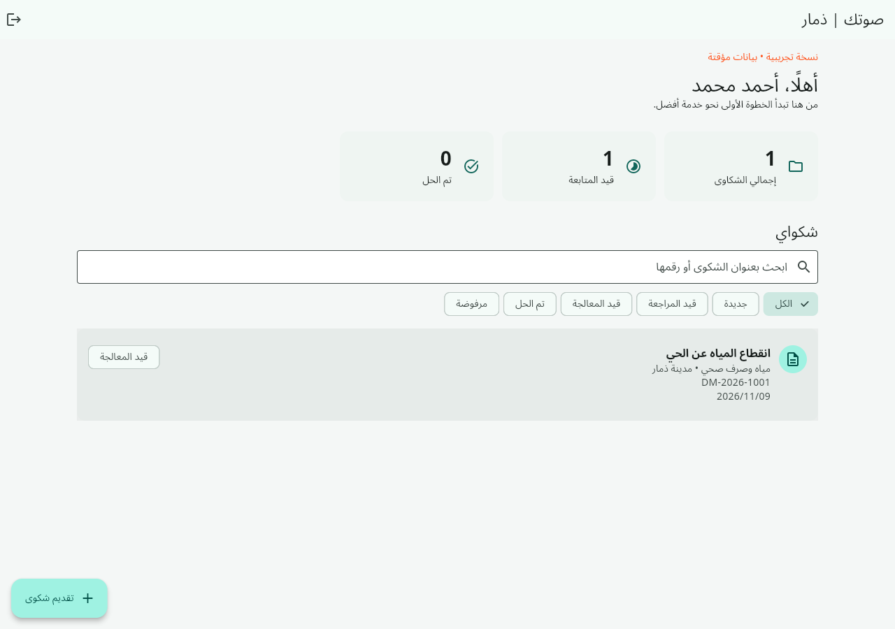

# صوتك | تطبيق شكاوى محافظة ذمار

مشروع Flutter عربي باتجاه RTL لتنفيذ الوظائف الأساسية الواردة في وثيقة مشروع التخرج: تسجيل المواطنين، تقديم الشكاوى، متابعتها، والمراسلة مع الإدارة. يعمل على Android والويب. هذا مشروع تعليمي مستقل؛ لا يمثل بوابة حكومية رسمية.

## الوظائف

- تسجيل حساب بالبريد وكلمة المرور، تسجيل الدخول والخروج، واستعادة كلمة المرور عبر Firebase.
- تقديم شكوى: العنوان، النوع، التفاصيل، المديرية، وبيانات المشكو عليه الاختيارية.
- حتى ثلاثة مرفقات PDF/JPG/PNG، بحد 5 ميجابايت لكل ملف.
- رقم متابعة، قائمة الشكاوى، البحث والتصفية، وتحديثات مباشرة عند الاتصال بـFirestore.
- محادثة محفوظة لكل شكوى، وسجل لتغييرات الحالة.
- لوحة إدارة لعرض الشكاوى، الرد عليها وتغيير حالتها؛ الصلاحية تُمنح من بيئة موثوقة.
- قواعد Firestore وStorage لعزل بيانات المواطنين ومنع منح النفس صلاحيات الإدارة.

## التشغيل التجريبي

ثبّت Flutter stable ثم نفّذ من مجلد المشروع:

```sh
flutter pub get
flutter run -d chrome
```

المواطن: `citizen@example.com`، المدير: `admin@example.com`، كلمة المرور للحسابين: `Demo12345!`.

الوضع التجريبي افتراضي، وبياناته في الذاكرة فقط. لا يرفع الملفات ولا يرسل رسائل بريد؛ الحساب الجديد فيه مؤقت للجلسة الحالية. للبيانات الدائمة استخدم Firebase كما هو موضح أدناه.

## الربط الفعلي

اتبع [دليل إعداد Firebase](docs/FIREBASE.md)، ثم:

```sh
flutter run -d chrome --dart-define-from-file=firebase-config.json
flutter build web --dart-define-from-file=firebase-config.json
flutter build apk --release --dart-define-from-file=firebase-config.json
```

لا تتوفر إعدادات Firebase خاصة بالمستخدم ضمن المستودع، ولم تُنشر قاعدة بيانات حية أو تطبيق على متجر. خدمات Firebase قد تتطلب تفعيل الفوترة، خصوصًا Storage. بناء APK يحتاج Android SDK وJava، والنشر للمتجر يحتاج توقيع إنتاج خاصًا بك.

## التحقق

```sh
flutter analyze
flutter test
flutter build web
npm ci
npm run test:rules
```

اختبارات القواعد تعمل على المحاكيات المحلية وتحتاج Java 21 وNode 22. ملف GitHub Actions يشغّل التحليل والاختبارات وبناء الويب واختبار الصلاحيات، ويحاول بناء APK تجريبي يمكن تنزيله من Artifacts بعد نجاح مهمة android-demo. راجع [نطاق التنفيذ](docs/REQUIREMENTS.md) و[دليل الاستخدام](docs/USER_GUIDE.md).

## تنظيم المشروع

| المسار | المسؤولية |
| --- | --- |
| `lib/main.dart` | واجهات المواطن والإدارة |
| `lib/models.dart` | نماذج البيانات والتحقق |
| `lib/store.dart` | مخزن تجريبي وربط Firebase |
| `firestore.rules`, `storage.rules` | قواعد الوصول والتحقق |
| `test/` | اختبارات Flutter |
| `rules-test/` | اختبارات صلاحيات Firebase |
| `tools/set-admin.mjs` | منح صلاحية الإدارة من جهاز موثوق |

لا تحفظ كلمات المرور في Firestore؛ تتولى Firebase Authentication إدارتها. لا ترفع مفاتيح حسابات الخدمة أو ملفات التوقيع أو بيانات المواطنين إلى GitHub.

## صور التطبيق والتحقق



راجع [تقرير التحقق ونتائجه](docs/VALIDATION.md) لمعرفة ما تم اختباره وحدود النسخة الحالية. الخط العربي Noto Sans Arabic مضمن محليًا بترخيص SIL OFL في `assets/fonts/OFL.txt`.
