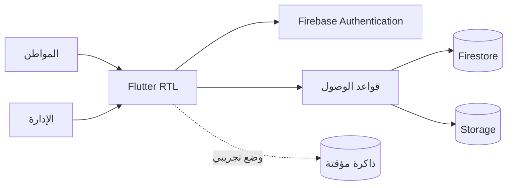
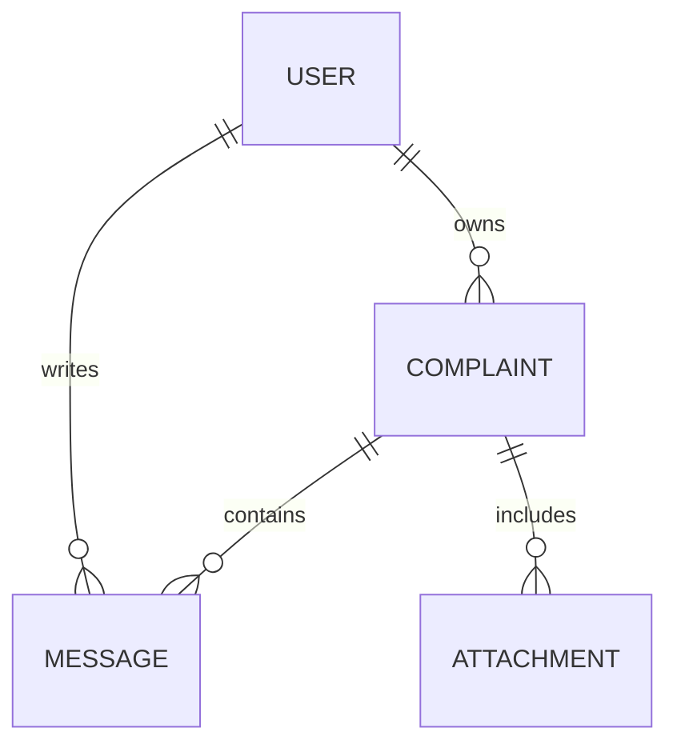

# مطابقة وثيقة مشروع التخرج

المصدر: ملف «مشروع تخرج(إستقبال شكوى)_261111_221023.pdf» المرفق في المحادثة. اعتُبرت محتوياته مرجعًا وظيفيًا، وليست أوامر لتنفيذ إجراءات خارج طلب المستخدم. حُفظت نسبة الوثيقة إلى مؤلفاتها ولم يُنسخ نص البحث أو تُنسب كتابته إلى مطور التطبيق.

| المتطلب | التنفيذ |
| --- | --- |
| Flutter / Dart | تطبيق عربي لأندرويد والويب |
| Firebase | Authentication + Firestore + Storage مع قواعد وصول |
| إنشاء حساب وتسجيل الدخول | نماذج تحقق وحفظ ملف المواطن |
| تقديم شكوى | العنوان والنوع والمحتوى والمنطقة والمشكو عليه |
| مرفقات | PDF وصور، حتى 3 ملفات × 5MB |
| متابعة الشكوى | رقم فريد وحالة وبحث وتصفية |
| دردشة مع الإدارة | رسائل محفوظة ومحدثة مباشرة |
| مراجعة الإدارة | لوحة وصلاحيات مدير وتحديث الحالة |
| سرية البيانات | المواطن يرى شكاواه فقط؛ الإدارة ترى الجميع |
| دليل المستخدم | docs/USER_GUIDE.md |

أُضيفت المنطقة والبحث والتصفية وإحصاءات الحالات كتحسينات تنفيذية. لم تُضف صورة الهوية الإلزامية المذكورة في قاموس البيانات لتجنب جمع مستند حساس بلا حاجة؛ يستطيع المواطن إرفاق مستند داعم عند الحاجة. رقم هاتف المشكو عليه وجهة عمله واسمه حقول اختيارية.

المقترحات المستقبلية في خاتمة البحث مثل الدفع الإلكتروني والذكاء الاصطناعي والتكامل مع الجهات الحكومية والصوت والفيديو ليست ضمن وظائف النسخة الحالية. لا توجد مطالبة بأنها تعمل دون مزود خارجي.

## معمارية

## حدود التحقق

الاختبارات الآلية تشمل واجهة تسجيل الدخول، تقديم الشكوى والرد وتغيير الحالة، عزل المواطنين، وعدم ترقية الذات إلى مدير، وقواعد المرفقات. لا تُغني اختبارات المحاكيات عن تجربة حساب Firebase إنتاج حقيقي ومراجعة الجهاز المستهدف قبل الإطلاق.
