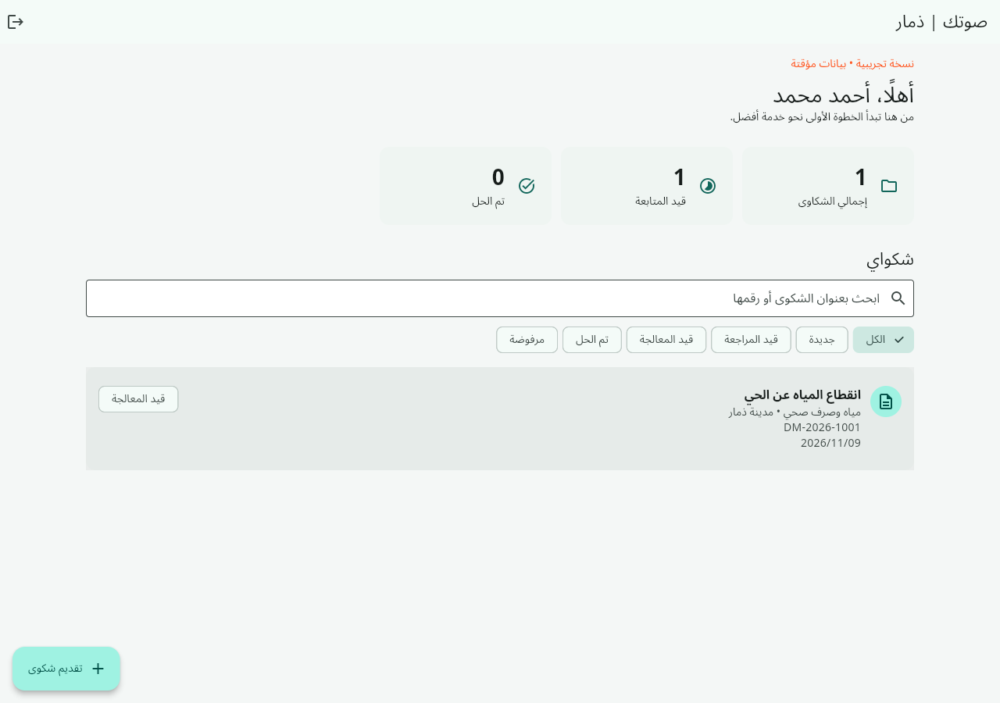
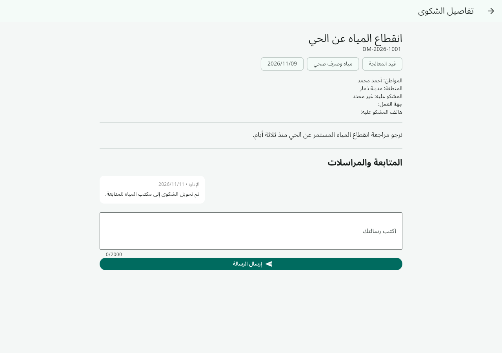

# تقرير التحقق

تاريخ التحقق: 11 نوفمبر 2026. البيئة: Linux، Flutter 3.50.0، Dart 3.14.0، Java 21.

| الفحص | النتيجة |
| --- | --- |
| flutter analyze | نجح دون ملاحظات |
| flutter test | نجحت الاختبارات الخمسة |
| Firebase Emulator Suite | نجح اختبار القواعد الشامل لـFirestore وStorage |
| flutter build web | نجح بناء نسخة تجريبية |
| Chromium / Playwright | نجح الدخول للمواطن وفتح لوحة التحكم وتفاصيل الشكوى دون أخطاء JavaScript |
| شاشة الهاتف 390×844 | نجح اختبار فتح الشكوى ونموذج تقديم شكوى دون overflow |
| بناء APK محليًا | لم يتم؛ Android SDK غير مثبت في بيئة التنفيذ |
| Firebase إنتاج | لم يُربط مشروع إنتاج؛ يلزم إعدادات صاحب المشروع |

اختبار القواعد يتحقق من رفض قراءة شكاوى الآخرين والقراءة دون تسجيل، ومنع ترقية الذات للإدارة، ومنع تغيير الحالة بواسطة المواطن، ورفض انتحال مرسل الرسالة، والسماح للمواطن بإرسال رسالة وإرفاق PDF وتحديث المرفقات، والسماح للإدارة بتحديث الحالة وإضافة حدث، ومنع تغيير مالك الشكوى، ورفض نوع مرفق غير مسموح أو رفعه/قراءته من غير المالك.

تجربة المتصفح استخدمت الخط العربي المحلي وCanvasKit المحلي. رُفض طلب خط Roboto احتياطي خارجي بسبب شهادة بيئة المتصفح؛ لم يمنع ذلك عرض الواجهة العربية أو إكمال الاختبار. صور الواجهة مأخوذة من النسخة التجريبية ولا تعرض بيانات مواطنين حقيقيين.

مهمة GitHub Actions مستقلة لبناء APK تجريبي؛ وجود ملف workflow لا يعني نجاحها. راجع تبويب Actions لمعرفة نتيجة كل مهمة وتنزيل المخرجات عند نجاحها. لا يوجد APK إنتاج موقّع أو تطبيق منشور على المتجر ضمن هذا التسليم.

